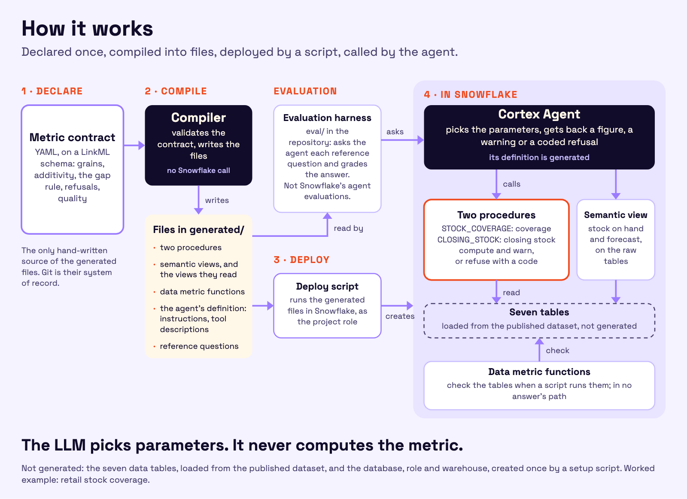

<p align="center">
  <picture>
    <source media="(prefers-color-scheme: dark)" srcset="assets/logo/freerange-header-dark.svg">
    
  </picture>
</p>

<div align="center">

[](./LICENSE)
[](https://www.snowflake.com/)
[](https://docs.snowflake.com/en/user-guide/snowflake-cortex/cortex-agents)
[](https://docs.snowflake.com/en/user-guide/views-semantic/overview)
[](https://linkml.io/)
[](https://yaml.org/)
[](https://www.python.org/)
[](https://docs.pytest.org/)
[](https://github.com/vincevv017/freerange-metrics/actions/workflows/tests.yml)
[](#)

</div>

<br/>

**freerange-metrics** declares one business metric, stock coverage (how many months the stock on hand lasts against
the demand forecast), with closing stock, in a YAML contract kept in Git, and compiles it into Snowflake procedures, a
semantic view and a Cortex Agent configuration: the agent picks the parameters, a generated procedure computes the
number or refuses with a code and a reason. Measured on one account with synthetic data, on 24 questions built from
the contract's failure modes: the agent with generated tools (C-raw) answered 21, one of them a pass that rests on a
grader limit ([Limits](#limits)); the same agent with closing stock from a gap-filled view (C) answered 24; five agents
on semantic views or skills alone answered 13 to 17 [measured]. <!-- stage1_results.md, sections 9 and 12;
snowflake/session13_craw/results.md, section 4 --> Caveat: on 10 turns over 7 questions neither agent had seen, C and
the generated semantic view alone (B2) both answered 8 of 10 <!-- stage2_results.md, section 3 -->. Outside the trap
questions, the advantage that remains is that only C and C-raw returned coded refusals and relayed them with their
reasons <!-- stage1_results.md, section 3, refusals; snowflake/session13_craw/results.md, section 4 -->, and that a
turn of C cost about a third of a turn of B2 <!-- docs/phase5_notes.md, finding 136 --> [measured]. C-raw is
recommended although it scores a little lower: it reads no reshaped data, gives the same closing stock as C on all
12,304 members, and its misses are in wording (mostly naming the basis), not in figures
<!-- snowflake/session13_craw/results.md, sections 3 and 4 --> [measured]. Start with the
[guided tour](docs/TOUR.md) or the [quickstart](#7-reproduce).

Tags used throughout: **[measured]** (run on the account or by the offline suite, evidence in this repository),
**[documented]** (Snowflake documentation, the contract or `docs/DEFINITION.md`), **[inferred]** (reasoning from
measured facts, not run).

**Orientation.** The project is freerange-metrics; inside, the Python package is `linkml_metrics` and the Snowflake
objects are `LINKML_*`, because the repository started as linkml-metrics. `contract/`, `compiler/`, `generated/` and
`tests/` are the product; `snowflake/` and `docs/` are the lab notebook, session by session.

## 1. How it works

<p align="center">
  
</p>

1. **Declare.** `contract/stock_coverage.yaml`, on the LinkML metamodel `contract/metamodel.yaml`, declares the grains,
   how each measure adds up, the rule for a missing snapshot, the refusals and the quality expectations. It is the only
   hand-written source of the generated objects; Git is their system of record.
2. **Compile.** The compiler (`compiler/`) validates the contract and writes the files of `generated/` (section 2);
   scripts under `snowflake/` deploy them, and the compiler itself calls nothing. The data tables are loaded from the
   published dataset, not generated. The offline suite regenerates every file and fails on any byte of difference. It
   runs locally and, with no Snowflake secret, on GitHub Actions at every push and pull request
   (`.github/workflows/tests.yml`).
3. **Generated in Snowflake.** Generated procedures compute at question time what needs a rule: coverage
   (`STOCK_COVERAGE`: it computes, recomputes totals, refuses) and closing stock (`CLOSING_STOCK`: the snapshot of the
   period's last month, 0 for a member with no row that month). A semantic view on the raw tables answers stock on hand
   and forecast. Data metric functions check the inputs; the procedures check them again in the call and return
   warnings. The agent configuration carries the tool specification, and the reference questions test it. A native
   semantic view can also serve closing stock, over a gap-filled snapshot the compiler generates (configuration C,
   section 3).
4. **Answer.** The agent picks the parameters and relays a figure or an explained refusal. It never computes the
   metric [documented, the contract and `compiler/`].

## 2. The contract in a minute

The heart of `contract/stock_coverage.yaml`, the metric itself (quoted from the file):

```yaml
metrics:
  - id: stock_coverage
    name: Stock coverage
    synonyms: [months of cover, coverage, stock cover, months of stock]
    description: Forward depletion of the stock at the analysis month t against the forecast of t+1 to t+H.
    snapshot_measure: stock_on_hand
    flow_measure: demand_forecast
    anchor_parameter: as_of_months
    time_grain: MONTH
    output_unit: months
    window_start_offset: 1
    horizon_periods: 24
    interpolation: LINEAR
    densify_missing_periods: true
    aggregate_before_compute: true
    time_filter_on_flow: SELECTS_ANCHOR_ONLY
    prevents: [T1, T2, T4]
    outcomes:
      - order: 1
        condition: SNAPSHOT_NULL_OR_ZERO
        result: "0"
        flag: NO_STOCK
        keeps_member: true
        prevents: [T8, T9]
```

What each key of the excerpt means [documented, the metamodel], and whether the compiler reads it [documented, `compiler/supported.py`]:

| Key | What it means | Read by the compiler |
|---|---|---|
| [`metrics`](docs/reference/metamodel.md#slot-metrics) | The metrics of the contract. `DepletionMetric` is the only pattern; the compiler reads the first entry. | yes |
| [`id`](docs/reference/metamodel.md#slot-id) | The metric's identifier, `stock_coverage`. | yes |
| [`name`](docs/reference/metamodel.md#slot-name) | Its human-readable name. | no: documentation |
| [`synonyms`](docs/reference/metamodel.md#slot-synonyms) | Other words for the metric; they go into the agent's tool description. | yes |
| [`description`](docs/reference/metamodel.md#slot-description) | The definition in one sentence; it goes into the tool description. | yes |
| [`snapshot_measure`](docs/reference/metamodel.md#slot-depletionmetric__snapshot_measure) | The level that is drained: `stock_on_hand`, read at the analysis month. | yes |
| [`flow_measure`](docs/reference/metamodel.md#slot-depletionmetric__flow_measure) | What drains it: `demand_forecast`, summed over the forward window. | yes |
| [`anchor_parameter`](docs/reference/metamodel.md#slot-depletionmetric__anchor_parameter) | The parameter that selects the analysis month: `as_of_months`. | fixed: only as_of_months supported |
| [`time_grain`](docs/reference/metamodel.md#slot-depletionmetric__time_grain) | The period of the anchor and of the window: MONTH (the generated SQL is monthly). | fixed: only MONTH supported |
| [`output_unit`](docs/reference/metamodel.md#slot-depletionmetric__output_unit) | The unit of the result: months, on every basis. | fixed: only months supported |
| [`window_start_offset`](docs/reference/metamodel.md#slot-depletionmetric__window_start_offset) | 1: the window starts the month after the analysis month, so that month's own forecast never counts (T4). | yes |
| [`horizon_periods`](docs/reference/metamodel.md#slot-depletionmetric__horizon_periods) | 24: the forecast of t+1 to t+24 is read; a month is a valid analysis month only when the calendar and the forecast reach it plus 24. | yes |
| [`interpolation`](docs/reference/metamodel.md#slot-depletionmetric__interpolation) | LINEAR: in the month the stock runs out, the fraction of that month's forecast it covers is added. | fixed: only LINEAR supported |
| [`densify_missing_periods`](docs/reference/metamodel.md#slot-depletionmetric__densify_missing_periods) | true: a month with no forecast row counts as 0, never as a skipped row (T2). | fixed: only true supported |
| [`aggregate_before_compute`](docs/reference/metamodel.md#slot-depletionmetric__aggregate_before_compute) | true: stock and forecast are summed to the grain asked before the algorithm runs, never computed per item and averaged (T1). | fixed: only true supported |
| [`time_filter_on_flow`](docs/reference/metamodel.md#slot-depletionmetric__time_filter_on_flow) | SELECTS_ANCHOR_ONLY: the month asked selects the stock; the forecast window stays relative to it, never cut by the filter (T4). | fixed: only SELECTS_ANCHOR_ONLY supported |
| [`prevents`](docs/reference/metamodel.md#slot-prevents) | The failure modes this element guards against (legend below). | no: traceability, read by the tests |
| [`outcomes`](docs/reference/metamodel.md#slot-depletionmetric__outcomes) | The outcomes, evaluated in order; the first matching condition decides the value and the flag. | fixed: only the four outcomes of the pattern, in this order (their flags are read) |
| [`order`](docs/reference/metamodel.md#slot-depletionoutcome__order) | An outcome's evaluation order, from 1. | fixed, with outcomes |
| [`condition`](docs/reference/metamodel.md#slot-depletionoutcome__condition) | The condition tested: `SNAPSHOT_NULL_OR_ZERO`, no stock at the analysis month. | fixed, with outcomes |
| [`result`](docs/reference/metamodel.md#slot-depletionoutcome__result) | The value returned: 0. | fixed: only 0 supported |
| [`flag`](docs/reference/metamodel.md#slot-depletionoutcome__flag) | The flag set on the row: `NO_STOCK`. | yes |
| [`keeps_member`](docs/reference/metamodel.md#slot-depletionoutcome__keeps_member) | true: the member keeps its row although it has no stock. | fixed: only true supported |
| [`prevents`](docs/reference/metamodel.md#slot-depletionoutcome__prevents) | For this outcome: T8 and T9. | no: traceability, read by the tests |

A key marked fixed is not read by the compiler: the generated objects are written for that one value, and a contract holding another one is refused by the generators (`<key>: only <value> is supported by this compiler`). The full list is `compiler/supported.py`; [docs/reference/metamodel.md](docs/reference/metamodel.md) marks each one.

The failure modes the excerpt names, each with the wrong behaviour it prevents [documented, the contract]:

- [**T1**](docs/reference/failure_modes.md#t1), Ratio re-aggregation: a coverage obtained by adding or averaging child coverages.
- [**T2**](docs/reference/failure_modes.md#t2), Sparse forecast months: a row-based window that skips the months with no forecast row.
- [**T4**](docs/reference/failure_modes.md#t4), Time filter pushed to forecast: the month filter cutting off the future forecast rows.
- [**T8**](docs/reference/failure_modes.md#t8), Forecast but no stock: a member with forecast and no stock disappearing from the answer.
- [**T9**](docs/reference/failure_modes.md#t9), Stale stock in coverage: the last snapshot before the analysis month used as its stock, so a stock-out shows a positive coverage.
- All 16 failure modes, each with its trap, its correct answer and the value of each wrong answer: [docs/reference/failure_modes.md](docs/reference/failure_modes.md).

The vocabulary lives in `contract/metamodel.yaml`, a LinkML schema; the reference in [docs/reference/](docs/reference/metamodel.md) is generated from it by `compiler/gen_reference.py`.

Around it, the contract declares the tables, the measures and their additivity, the attributes and which measure
each applies to, the bases (kg or L equivalent, value, the item's own unit), the parameters, 21 refusal codes in check
order, 28 quality expectations and 16 failure modes (`docs/CONTRACT.md` reads it section by section). The compiler
generates [documented, the contract]:

| Generated file | Generator | What it is |
|---|---|---|
| `generated/schema.py` | `gen_schema.py` | tables, columns, grains, attribute classes and bases, imported by the loader, the checks and the tests |
| `generated/dmf.sql` | `gen_dmf.py` | one custom data metric function per custom quality expectation, and ad hoc checks |
| `generated/closing_stock_sv.sql` | `gen_closing_sv.py` | the gap-filled snapshot view `FCT_STOCK_SNAPSHOT_GAPFILLED` and the native semantic view `CLOSING_STOCK_SV` |
| `generated/closing_stock_procedure.sql` | `gen_closing_procedure.py` | `CLOSING_STOCK`, the SQL Scripting procedure C-raw calls for closing stock: the period rule at question time on the raw snapshot, no densified data |
| `generated/c_raw_sv.yaml`, `generated/agent_c_raw.yaml` | `gen_craw.py` | configuration C-raw: its semantic view on the raw tables (stock on hand, forecast) and its agent spec (three tools) |
| `generated/stock_coverage_procedure_sql.sql` | `gen_procedure.py --target sql` | `STOCK_COVERAGE`, the SQL Scripting procedure agents C and C-raw call |
| `generated/stock_coverage_procedure.sql` | `gen_procedure.py --target python` | the Python target of the same procedure (`STOCK_COVERAGE_PY`), kept beside it |
| `generated/agent_c.yaml` | `gen_agent.py` | agent C's spec: instructions, tool descriptions, procedure binding |
| `generated/b2_native_views.sql`, `generated/b2_native_sv.yaml`, `generated/agent_b2.yaml` | `gen_native_sv.py` | configuration B2: the forward spine, status bridge and item projection, its semantic view and its agent spec |
| `generated/reference_questions.yaml` | `gen_questions.py` | the reference questions and their expected values, from the contract's failure modes, `data/traps.yaml` and the dataset |

<!-- counts: contract/stock_coverage.yaml, refusal_codes, quality_expectations, failure_modes -->

What holds it: `tests/test_generated.py` regenerates every file into a temporary folder and fails on any byte of
difference; `tests/test_charter_conformity.py` checks every sentence the charter imposes in the seven agent specs;
`tests/test_contract.py` validates the contract against the metamodel [measured, the offline suite].

## 3. The worked example: closing stock, then stock coverage

**Closing stock: native first, then generated.**
- **Native `NON ADDITIVE BY` is right on dense snapshots and silently wrong on a gap in the period's last month.**
  SKU-H11 in Switzerland has no June snapshot; asked for its Q2 2026 closing stock, the best native semantic view
  returns **350** (May's stock carried into the quarter's close) instead of **0**, and the SKU rows no longer add up to
  the family row (**800 against 450**) <!-- snowflake/probe_closing/results.md, session 6 summary and session 7
  summary --> [measured, session 6]. No error is raised; the number looks plausible [inferred].
- **The contract declares the rule** (a member with no snapshot in the period's last month closes at 0) **and the
  compiler generates a gap-filled snapshot under a native semantic view.** The same questions return 0, and 450 = 450.
  Cost: **2,513 rows added to 60,915 (+4.13 percent)**; over every SKU x country x quarter of the data, **0 failures
  in 2,702 groups** against 1 for the native view <!-- snowflake/probe_closing/results.md, session 7 --> [measured,
  session 7]. The 12 family groups that still differ from the reference in both views are all trap T7 (a duplicated
  item row) <!-- snowflake/probe_closing/results.md, session 7, point 3 --> [measured]; a semantic view has no way to
  refuse such a query at query time, as the contract asks [inferred].
- **Or at question time, with no densified data (C-raw).** The compiler also generates `CLOSING_STOCK`, a procedure
  that applies the same period rule to the raw snapshot when the question is asked, and refuses a period with a month
  that has no snapshot. Against the gap-filled view summed under the same rule, over 14 quarters and years, 16 grains
  and 2 bases: **12,304 of 12,304 members equal**, 0 differences <!-- snowflake/session13_craw/results.md, section 3 -->
  [measured].

The closing-stock trade-off, side by side:

| | C-raw: `CLOSING_STOCK` at question time | C: the gap-filled view under a semantic view |
|---|---|---|
| Data it adds | none | none stored, but a view of 63,428 rows over 60,915 (+4.1 percent), recomputed over the whole table on every query: a one-quarter question scans 2.0 times the snapshot table <!-- snowflake/session13_craw/results.md, section 1b --> [measured] |
| Growth | the snapshot rows of the period asked [inferred] | each key's span from its first period to its last + 1, at most keys x periods, whatever period is asked [inferred] |
| Per closing-stock turn | about **70,000 input tokens**, **1 to 5 s more** (median per stage), **5.2 s of compilation** per procedure call (median 6.4 s a call) <!-- snowflake/session13_craw/results.md, sections 3 and 4 --> [measured] | about 164,000 input tokens <!-- snowflake/session13_craw/results.md, section 4 --> [measured] |

The growth row is a reading of the SQL, not a measurement: no larger dataset was run, so C-raw's advantage at scale
is inferred. At this data size its procedures scan more bytes, not fewer: a coverage question scans 7.75 MB in
`STOCK_COVERAGE` against 2.73 MB through B2's coverage metric <!-- snowflake/session13_craw/results.md, section 1b -->
[measured].

**Stock coverage: why it needs a tool.**
- **It cannot be a native metric over window metrics.** A derived coverage metric over the 24 forward window metrics
  is rejected with `010273` "Unsupported window metrics in derived metric" <!-- docs/phase0_findings.md, section 2,
  builds tried --> [measured, phase 0]. The generated native view (B2) carries coverage over a precomputed forward
  spine instead.
- **On that view, stale stock hides a stock-out (trap T9).** SKU-H11 x CH holds 350 in May and nothing in June. With
  the month filter equal to June 2026 the view returns the right 0; with a range or a quarter it returns **1.1667**,
  and with no month **0.0493** <!-- snowflake/probe_closing/results.md, T9 section --> [measured, session 7]. No
  instructed agent reproduced it as a wrong figure over the campaign, whose question names June 2026, the one form
  under which the view is right <!-- stage1_results.md, section 4; stage2_results.md, section 2 --> [measured]; that
  this is why is a reading [inferred].
- **The generated procedure as the agent's custom tool.** `STOCK_COVERAGE` computes the coverage, computes totals by
  recomputation (never by adding child coverages), and refuses with a code what it cannot compute correctly
  [documented, the contract].

Three of the questions it answers ([the full list by type](docs/GUIDE.md#5-questions-you-can-ask), each with C's
measured outcome) <!-- generated/reference_questions.yaml; stage1_results.md, section 9; stage2_results.md, sections 2
and 3 -->:
- "Worldwide, which 10 products will stock out first from June 2026, not counting those already out?" Ten products
  with their stock-out months; the three already out or without demand set apart and named.
- "Across all countries, which item and country pairs have more than 12 months of coverage in June 2026, and how much
  stock value does that tie up?" 28 pairs holding 71.0 million EUR of stock: a stock value identified, not a saving.
- "What is the stock coverage of cooking oils in Sweden by lifecycle status as of June 2026?" Refused,
  `MASTER_DATA_FANOUT`: an item has two records that disagree on its status.

## 4. The evidence

### The seven configurations

One agent shape, one orchestration model (`claude-sonnet-5-5`), one response instruction, one caller (a service user
holding the project role only). What differs is what the agent gets for coverage and closing stock, and what its
tools read. The fairness charter is [docs/configurations.md](docs/configurations.md) (version 11 for the campaign,
version 12 adds C-raw).

| Configuration | Semantic view tool | Coverage | Closing stock | What its tools read |
|---|---|---|---|---|
| **C-raw** | `LINKML_C_RAW_SV`, generated on the raw tables (stock on hand, forecast) | **`STOCK_COVERAGE`** | **`CLOSING_STOCK`** | **raw only**: the seven tables, through the view and both procedures |
| C | B2's view, its coverage claim removed | `STOCK_COVERAGE` | B2's view | the procedure: raw; the view: generated (gap-filled snapshot, forward spine, status bridge, item projection) |
| A | `AP_LINKLM`, built by Semantic View Autopilot, untouched | none | the view | raw |
| B1 | `LINKML_B1_SV`, written by hand (window metrics, `NON ADDITIVE BY`) | none | the view | raw |
| B2 | `LINKML_B2_SV`, generated from the contract (coverage as a metric) | the view | the view | generated, as C's view, with the raw forecast |
| D | B2's view | skill `linkml-coverage` under `code_execution`: the agent extracts the inputs, a script computes | B2's view | generated (the sandbox reads no table) |
| D′ | B2's view | the same skill under `code_toolset_all`: the agent writes the extraction queries, the script runs them | B2's view | generated, and the tables the agent's queries name, recorded per turn |

<!-- docs/configurations.md, section 2 and version 12; snowflake/session13_craw/results.md, section 1a -->

Instructions: C and C-raw generated from the contract (C-raw: C's, with closing stock routed to `CLOSING_STOCK`); B2
generated; A, B1, D and D′ from `docs/DEFINITION.md`. C-raw has three tools, the others two at most.

**The reshaped objects that C, B2, D and D′ read** (generated views, nothing stored) [measured, one read; growth
inferred] <!-- snowflake/session13_craw/results.md, section 1b -->:
- **The gap-filled snapshot** (`FCT_STOCK_SNAPSHOT_GAPFILLED`): 63,428 rows for 60,915 snapshot rows (+4.1 percent).
  It grows with each key's span (first period to last + 1, at most keys x periods) and is computed over the whole
  table on every query.
- **The forward spine** (`B2_FORECAST_SPINE`, read by B2's coverage metric): 23,652 rows, 36 analysis months x 219
  item and country pairs x 3 lot statuses, each row 48 measure columns, 24.7 times the forecast's measure cells. It
  grows as analysis periods x pairs x statuses rows, times horizon x bases cells; at a daily grain both the analysis
  periods and the horizon grow about 30 times.
- At this size the procedures do not scan less: a coverage question scans 7.75 MB in `STOCK_COVERAGE` against 2.73 MB
  through B2's coverage metric [measured].

### The campaign

Stage 1: the 24 questions once on each of the six configurations, 144 graded turns. Correct of 24, counts not rates
(one repetition per cell) [measured]. C-raw, built in session 13, played C's 24 questions in C's order; it is not in
the 144:

| Configuration | Right figure, basis named, no unit on the coverage (rubric 3.2, of record) | Rubric 3.3 | Right figure, basis named | Latency per turn, median (s) | Agent AI Credits per graded turn, billed, median |
|---|---|---|---|---|---|
| A | 16 | 18 | 19 | 27.5 | 0.0690 |
| B1 | 13 | 16 | 19 | 16.9 | 0.0547 |
| B2 | 15 | 18 | 19 | 30.4 | 0.1042 |
| **C** | **24** | **24** | **24** | **16.3** | **0.0195** |
| C-raw | 21 | 22 | 22 | 19.0 | 0.0195 |
| D | 17 | 18 | 20 | 28.4 | 0.0972 |
| D′ | 15 | 18 | 19 | 36.8 | 0.0814 |
| All six, of 144 | 100 | 112 | 120 | | |

<!-- scores: stage1_results.md, sections 9 and 12; latency: section 3; credits: section 8; C-raw: snowflake/session13_craw/results.md, sections 4 and 5 -->

Wording costs every setup except C, at 24 either way; on figures alone, the generated tools score 24 and 22, the
others 19 to 20 [measured].

Stage 2 (reduced, owner's plan): C against B2, 30 graded turns each: the 16 questions the gate selected, four stage 1
questions it left out, the four held-out questions and three new ones [measured]. C-raw played C's 30 turns in session
13; its bill is not split by stage:

| Configuration | Right figure, basis named, no unit on the coverage (rubric 3.2, of record) | Rubric 3.3 | Right figure, basis named | Latency per turn, median (s) | Agent AI Credits per graded turn, billed, median | Billed, all costs |
|---|---|---|---|---|---|---|
| **C** | **27 of 30** | **28 of 30** | **29 of 30** | **17.5** | **0.0251** | **3.59 USD** |
| C-raw | 26 of 30 | 28 of 30 | 29 of 30 | 18.3 | 0.0223 | both stages: 5.02 USD |
| B2 | 20 of 30 | 22 of 30 | 25 of 30 | 30.1 | 0.1093 | 8.69 USD |

<!-- stage2_results.md, sections 2, 6, 7 and 8; C-raw: snowflake/session13_craw/results.md, sections 4 and 5 -->

**C-raw, beside C and B2, by class** (session 13: C-raw played C's questions in C's order; correct, with rubric 3.3
in brackets) <!-- snowflake/session13_craw/results.md, section 4; eval/mechanism_recount.py for C and B2 --> [measured]:

| Stage | Class (turns) | C-raw | C | B2 |
|---|---|---|---|---|
| 1 | Coverage (16) | 14 (15) | 16 (16) | 8 (11) |
| 1 | Closing stock and stock on hand (4) | 3 (3) | 4 (4) | 4 (4) |
| 1 | General (1) | 1 (1) | 1 (1) | 1 (1) |
| 1 | Refusal or clarification (3) | 3 (3) | 3 (3) | 2 (2) |
| 1 | **Total (24)** | **21 (22)** | **24 (24)** | **15 (18)** |
| 2 | Coverage (19) | 15 (17) | 16 (17) | 11 (13) |
| 2 | Closing stock and stock on hand (8) | 8 (8) | 8 (8) | 7 (7) |
| 2 | of which also coverage: N1, N2 (4) | 4 (4) | 4 (4) | 3 (3) |
| 2 | General (1) | 1 (1) | 1 (1) | 1 (1) |
| 2 | Refusal or clarification (2) | 2 (2) | 2 (2) | 1 (1) |
| 2 | **Total (30)** | **26 (28)** | **27 (28)** | **20 (22)** |

How to read C-raw against C:
- **The scores as they are.** Stage 1: 21 against 24 under rubric 3.2, 22 against 24 under 3.3. Stage 2: 26 against
  27 under 3.2, 28 against 28 under 3.3 [measured]. Both stage 1 counts of C-raw include T9, which passed the basis
  wording only because its answer quoted the product name "oat cereal bar 1 kg": the grader read that "kg" as the
  kg-equivalent basis named (finding 128). C-raw had passed `NATIVE`, as it did in T9 of stage 2 (second
  repetition), whose answer did not quote the name and failed <!-- eval/fixtures/grades_craw-s1.json,
  grades_craw-s1.rubric-3.3.json, grades_craw-s2.json; eval/grade.py, BASIS_WORDS --> [measured]. No regrade; no
  score changed. No C-raw verdict depends on finding 129 (Limits) [measured].
- **Closing stock without densified data: 11 of 12 turns**, each through `CLOSING_STOCK`, none through the view. The
  twelfth, G2 in stage 1, is wrong under the rubric: the figures are right, written in a table headed "EUR M", which
  the rubric's reading of a scale word next to each number does not match [measured; not regraded].
- **Coverage: the procedure is the same.** Every coverage difference is in the agent's choice and naming of the
  basis. In T3 (stage 1) and T9 (stage 2, second repetition) C-raw returned the expected figure (6.0 months; 0 with
  `NO_STOCK`) on the item's own unit and named that unit, where the rubric expects the kg-equivalent basis named: a
  wording error, not a figure error [measured].
  Both questions name no basis and are each about one item. Two sentences of every C and C-raw spec point to different
  bases for such a question: the basis rule, "Stock and forecast are measured on one basis before the ratio: the
  item's own unit for a single item; kg or L equivalent for items of the same dimension, unless the question asks for
  value (EUR); value only when items of different dimensions are combined.", and the default parameter, "Pass basis
  QTY_EQ unless the question asks for value or for one item in its own unit (NATIVE)." [documented,
  `generated/agent_c_raw.yaml`, `generated/agent_c.yaml`]. C-raw followed the basis rule and passed `NATIVE`; C
  (`QTY_EQ` on the same turns), the reference parameters and the rubric follow the default-parameter sentence
  [measured]. The figure is the same on either basis [measured]; the two turns are counted wrong, not regraded.
  NO_DEMAND (stage 1) and T8 (stage 2) read a pack size as a unit under 3.2 and are correct under 3.3;
  S_STOCKOUT_COUNTRY (stage 2) said "in kg or L equivalent" about the coverage figures.
  C-raw passed the item's own unit (`NATIVE`) in 13 of its 46 coverage calls, C in 7 of 45 [measured];
  the ambiguity of the two sentences above may explain it [inferred].
- **One repetition per question in stage 1; in stage 2, one more for each stage 1 question and two for each new one**
  (C-raw played C's turns). That does not establish whether these differences are between the configurations or
  between runs.

C over the campaign, on the 20 questions it played in both stages: **39 of 40** on rubric 3.2, **40 of 40** on rubric
3.3 and on the figure-only score, which bounds its error rate on them below **7.2 percent** at 95 percent
(1 − 0.05^(1/40)). B2 on the same questions: 23 of 40 (3.3: 28). On the 7 questions neither agent had seen before
stage 2 (the 4 held-out questions and the 3 new ones), C and B2 both answered **8 of 10**
<!-- stage2_results.md, sections 3 and 8 --> [measured]. C's measured advantage is on the questions drawn from the
contract's failure modes, the traps; elsewhere it is cost, speed and coded refusals [inferred from the counts above].

How to read these scores:
- **Rubric 3.2 is the score of record.** Rubric 3.3 was written after the campaign (owner, 2026-10-07): it stops
  reading a product name's pack size ("Oat cereal bar 1 kg") as the unit of a coverage, and stops counting "after n
  months" as a coverage figure. Every verdict it changes (12 in stage 1, 3 in stage 2, all wrong to correct) is listed
  with its sentence in `stage1_results.md` section 12 and `stage2_results.md` section 8 [measured].
- **Right figure, basis named** (the figure-only score) is the same grader without the unit half of the wording rule, published so that a
  wording defect can be told from a wrong number <!-- stage1_results.md, section 9 --> [measured].
- AI Credits are billed per call and priced 2.00 USD here; the warehouse and the guardrail model are billed apart
  (see the cost below) <!-- stage1_results.md, section 8 -->.

### Refusals, as the agent wrote them

In stage 1 only C returned coded refusals and warnings; every other configuration refused in prose
<!-- stage1_results.md, section 3, refusals --> [measured]. C, stage 1, quoted from the recorded answers
(`eval/fixtures/grades_campaign-s1.json`) [measured]:

- **T7_R1, an item with two lifecycle statuses** (A, B1, B2 and D gave the fanned-out 2.25 and 6.0 instead):
  "I can't give you this figure. The coverage tool refused the request with the code MASTER_DATA_FANOUT. [...] At
  least one cooking-oil item has more than one record, and those records disagree on lifecycle status."
- **DIM_MIX, kg and litres in one country:** "I switched to value because the default kg/L-equivalent basis was
  refused (BASIS_NOT_COMPARABLE). France's items mix kg and L, so their quantities can't be added together."
- **NO_DEMAND, a discontinued item:** "There is no coverage figure for SKU-H09 [...] The tool flagged it NO_DEMAND.
  The demand forecast is 0 L for the next 24 months [...] so months of cover is undefined."

### How it was measured

- **Questions and traps.** 24 stage 1 questions (`generated/reference_questions.yaml`): the contract's failure modes,
  closing-stock questions, a drill, general and selection questions; 4 held-out questions and 3 new ones in stage 2
  <!-- stage1_results.md, header; stage2_results.md, section 4 -->. Each trap in `data/traps.yaml` pins a member that
  forces one behaviour and declares both the right value and the value each named wrong behaviour returns, so that a
  trap is detectable [documented, `data/traps.yaml`]. The route fields of the reference questions (`expected_route`,
  `answered_by`) describe C's routing; C-raw's routes are in `eval/grade.py` (`CR_ROUTING`) [documented].
- **Two independent oracle references.** Every expected value is recomputed from the dataset alone by a procedural
  pandas implementation and a set-based DuckDB implementation (`data/coverage_ref.py`, `data/checks/check_dataset.py`,
  `tests/test_reference_oracle.py`); none comes from the procedure under test [measured, the offline suite]. Their
  agreement is an equivalence check; correctness comes from the hand-computed trap values.
- **Rubric and grader.** `eval/rubric.yaml` (3.2, frozen for the campaign; 3.3 after it), applied by a scripted
  grader, `eval/grade.py`, on the answer text, the tool calls and the tables of each turn. A turn the grader cannot
  decide goes to the owner; the decisions are in `eval/manual_decisions.yaml`, with their rule.
- **The gate between the stages.** `eval/gate.py` (`eval/gate.md`) selects the stage 1 questions that discriminate
  (a failure, or answers that differ in value, products, parameters, warnings or refusal), with a relative tolerance
  on amounts and an absolute one on months.
- **Served-version checks.** Before each block, the agent's default version must equal the frozen state of
  `eval/campaign.md`; after the stage, every call's served version is read from its own trace rows. All 180 graded
  REST calls of stage 1 and all 60 turns of stage 2 were served by their frozen version
  <!-- stage1_results.md, section 1; stage2_results.md, section 1 --> [measured]. The 54 graded turns of C-raw were
  served by its frozen version, `VERSION$2` <!-- snowflake/session13_craw/results.md, section 4 --> [measured].
- **Cost reads.** One read-only batch on `SNOWFLAKE.ACCOUNT_USAGE` after each stage, billed rows matched to the
  harness's calls by request id, one to one <!-- stage1_results.md, section 8; stage2_results.md, section 7 -->
  [measured].

Query ids and request ids in the evidence are replaced by numbered placeholders of the same shape; the same
placeholder stands for the same id in every file. The stage results: [stage 1](snowflake/phase5_campaign/stage1_results.md),
[stage 2](snowflake/phase5_campaign/stage2_results.md).

### Limits

- **One account, one region**, one pinned orchestration model (`claude-sonnet-5-5`) on every turn
  <!-- docs/phase0_findings.md, section 1; stage1_results.md, section 1 -->.
- **One metric pattern, one instance.** The contract, the compiler and the campaign are built and evaluated on stock
  coverage only; a dry run on a second metric is described in [Scope](#5-scope).
- **Synthetic data**: a multi-country grocery retailer, 60,915 stock snapshot rows and 15,306 forecast rows
  <!-- data/output/manifest.json -->. In the background data the native closing-stock defect touches one group <!-- snowflake/probe_closing/results.md, session 7, point 4 --> [measured,
  session 7], so the traps are what exposes it [inferred].
- **Small samples.** One repetition per question in stage 1: each cell is a count, never a rate. Stage 2 played each
  stage 1 question it kept once more, the 4 held-out questions once and the 3 new ones twice; the C-raw arm played
  C's turns <!-- stage2_results.md, sections 3 and 4 -->. The only bound given is C's, pooled over 40 trials on seen
  questions.
- **Home advantage.** The questions were drawn from the contract's own failure modes, and the rubric and the grader
  were written by the contract's author. What mitigates it: the fairness charter, frozen before the campaign, gives
  every configuration the same agent shape, model, response instruction and caller ([docs/configurations.md](docs/configurations.md));
  4 questions were held out until stage 2 and 3 were written for it, and on those 7 C and B2 tie at 8 of 10; every
  expected value is recomputed from the dataset alone by two independent oracle references [measured]. What does
  not: the held-out and new questions were written by the same author, the basis wording the rubric asks for is the
  contract's vocabulary, and no grader from outside the project read the answers [documented, `eval/rubric.yaml`,
  `eval/grade.py`].
- **Rubric 3.3 was written after the campaign.** Both scores are given, 3.2 stays the score of record, and every
  changed verdict is listed in the stage results.
- **Two documented limits of rubric 3.3**, frozen with it: the naming half of the wording rule reads a product name's
  "1 kg" as the basis named (finding 128), and counts of forecast months other than "after n months" ("the first 8
  months") stay coverage candidates (finding 129). In the campaign's six configurations no verdict depends on either
  <!-- docs/phase5_notes.md, findings 128 and 129 -->. In the C-raw arm one verdict depends on finding 128: C-raw's
  T9 in stage 1 passed the basis wording only because its answer quoted the product name "oat cereal bar 1 kg",
  whose "kg" matched the QTY_EQ word list; the same basis choice without the name, T9 in stage 2 (second
  repetition), failed <!-- eval/fixtures/grades_craw-s1.json, grades_craw-s2.json; eval/grade.py, BASIS_WORDS -->
  [measured]. No C-raw verdict depends on finding 129: its forms occur only as "within 3 months", in four selection
  turns (S_STOCKOUT_COUNTRY in both stages, H_LOCAL_STOCKOUT, H_STOCKOUT_ES), and grading those 54 turns again
  without them changes no criterion <!-- eval/fixtures/grades_craw-s{1,2}{,.rubric-3.3}.json;
  tests/test_rubric_33.py, test_no_craw_verdict_depends_on_finding_129 --> [measured].
- **The generated instructions are ambiguous for a single item asked without a basis**: the basis rule gives
  the item's own unit, the default-parameter sentence gives `QTY_EQ` [documented, `generated/agent_c.yaml`,
  `generated/agent_c_raw.yaml`]. A point for the contract after the article; contract 0.5.1 and the generated
  files are unchanged <!-- snowflake/session13_craw/results.md, T3 and T9 -->.
- **D′ is bound by the harness's strict command allow-list**: a bash command is approved only when it is exactly a
  run of the skill's script; a run followed by a pipe and a redirection was denied as written
  <!-- docs/configurations.md, section 2; docs/phase5_notes.md, finding 58 -->. D′ also reached its per-question cap
  of 4 REST calls with no final answer on two selection questions <!-- stage1_results.md, section 5 -->.
- **The 8 s per turn target the author set before the build was missed.** C's median turn took 16.3 s in stage 1
  and 17.5 s in stage 2 <!-- stage1_results.md, section 3; stage2_results.md, section 6; the 8 s target: the 8 s per
  turn target the author set before the build (the author's statement) --> [measured].
- **C-raw's 8 refusal texts of `CLOSING_STOCK` are written in the generator, not declared in the contract.** The
  contract's templates were written for coverage; the generator rewords the 8 that name coverage or `as_of_months`
  and stops if the contract's text changes <!-- snowflake/session13_craw/results.md, section 2 -->.
- **The data metric functions are generated, not attached or scheduled.** `generated/dmf.sql` creates 17 functions
  and 36 ad hoc checks; `snowflake/phase2_dmf/run_dmf.py` ran the checks once. Nothing attaches a function to a table
  or sets a schedule (`tests/test_generated.py` asserts it). The procedures check the same expectations again in
  every call [documented, `generated/dmf.sql`, `docs/GUIDE.md` section 3].
- **Deployment is a sequence of manual commands** (section 6), one script per object, run by hand in order; there is
  no single deploy command [documented, section 6].
- **`CLOSING_STOCK` spends about 5 s compiling on every call**: 5.2 s of compilation against 0.86 s of execution,
  median 6.4 s a call over 10 warm calls <!-- snowflake/session13_craw/results.md, section 3 --> [measured].
- **C-raw has three tools, the other configurations two at most.** Its closing-stock turns read fewer input tokens
  than C's view turns, its coverage turns slightly more <!-- snowflake/session13_craw/results.md, section 4 -->
  [measured].
- **C-raw passed `NATIVE` more often than C** (13 of 46 coverage calls against 7 of 45); the cause is not established
  <!-- snowflake/session13_craw/results.md, section 4 --> [measured].
- **D′ failed to load its skill from the Snowsight chat** (`Skill not found`, error 500); over REST as the service
  user, the path the campaign uses, it loads <!-- docs/phase5_notes.md, part 1 --> [measured; the cause inferred].

### Cost of the experiment

The campaign billed **44.93 USD**: agent **33.32**, guardrail model **0.75**, warehouse **10.86**. The harness
estimated 41.15 USD; the bill was **9.2 percent** above it: the agent credits matched to the call, and the gap is the
warehouse rate, its auto-suspend tails and the guardrail, none of them in the estimate
<!-- stage2_results.md, section 7, "The campaign, both stages billed"; docs/phase5_notes.md, finding 135 --> [measured].
Per graded turn, C costs about **3 times less** than B2 in agent credits (stage 2, billed: mean 0.0379 against
0.1087 credits, 2.9 times) <!-- docs/phase5_notes.md, finding 136 --> [measured]. This is the campaign only; no
total is given for the whole project.

C-raw (session 13), billed: building and checking it (direct calls, parity, smoke) **2.37 USD**, inside the
estimate of 1.8 to 2.4; the arm of 54 graded turns **5.02 USD** (agent 2.75, warehouse 2.27), 17.5 percent above the
estimate of 4.27 USD. The agent credits of the 60 calls match the estimate by request id to the fourth decimal (0.024
to 0.025 credits a call); the gap is the warehouse rate and its auto-suspend tails. The guardrail model adds 0.08 USD,
and an on-account test file run by a plain `pytest` before the session's work (since gated) 1.15 USD, counted apart
<!-- snowflake/session13_craw/results.md, section 5 --> [measured].

## 5. Scope

This repository measures one metric, stock coverage, with closing stock. It is not a general metrics framework.

- **One metric, measured.** The contract, the compiler, the deployed objects and the campaign all serve stock
  coverage [measured, section 4].
- **A dry run on a second metric needed five concessions.** Cash runway (cash on hand drained by planned spend) was
  compiled offline. Written in its own words, it validates, and its schema, data metric functions and closing view
  generate. The procedure and the agent specification generate only after it adopts stock coverage's 8 parameter
  ids, its 21 refusal codes, three bases, a calendar named `DIM_CALENDAR` and a `grain_rule`. Even then they cannot
  be deployed [measured, `docs/dry_run/results.md`].
- **The compiler fixes 26 keys.** A contract that holds a value other than the supported one (a monthly grain, LINEAR
  interpolation, the four outcomes in order) is refused; 12 more keys are documentation only [documented,
  `compiler/supported.py`].
- **What a second deployable metric would have to open:** the object names, which are constants in the generators
  (`STOCK_COVERAGE`, `CLOSING_STOCK`, `CLOSING_STOCK_SV`, the agent's tools), so a second metric would replace the
  first in the same schema; `item_id` in the procedure's SQL; answer keys named after stock; the calendar's column
  names; fixed stock coverage text in the agent specification; a question set built from stock coverage's traps; and,
  for any other shape (a ratio, a rate, a cohort), a metric class and a SQL template, because `metrics` accepts
  `DepletionMetric` only [measured and inferred, `docs/dry_run/results.md`; documented, `contract/metamodel.yaml`].

Details: [docs/dry_run/results.md](docs/dry_run/results.md),
[TOUR section 5](docs/TOUR.md#5-what-is-generic-today-and-what-is-fixed),
[GUIDE section 6](docs/GUIDE.md#6-adding-a-metric).

## 6. Why not MetricFlow, native semantic views or Apache Ossie?

This project did not run MetricFlow or Ossie: the comparison rests on their documentation, read on 2026-10-09, for
MetricFlow v0.213.0 (released 2026-09-10) and the Ossie specification 0.2.0.dev0 (draft, commit `28a91f5` of
2026-10-09).

- **Native semantic views (Snowflake).** `NON ADDITIVE BY` makes a metric semi-additive: the rows are sorted by the
  non-additive dimensions and the values of the last rows are aggregated
  [documented, [CREATE SEMANTIC VIEW](https://docs.snowflake.com/en/sql-reference/sql/create-semantic-view)].
  Measured here: for a member with no snapshot in the quarter's last month, the best native view returns May's stock
  (350 instead of 0) and raises no error ([section 3](#3-the-worked-example-closing-stock-then-stock-coverage))
  [measured]. "Window function metrics cannot be used in the definitions of other metrics" [documented,
  [validation rules](https://docs.snowflake.com/en/user-guide/views-semantic/validation-rules)]. Measured here: a
  derived coverage over the 24 forward window metrics is rejected with `010273` (section 3) [measured].
- **Apache Ossie, formerly Open Semantic Interchange (OSI).** A YAML and JSON specification for exchanging metrics,
  dimensions and relationships between tools, in the Apache Incubator since July 2026 [documented,
  [announcement](https://ossie.apache.org/updates/ossie-enters-apache-incubator/),
  [repository](https://github.com/apache/ossie)]. It is a specification, not an execution engine. Its Snowflake
  converter writes a Cortex Analyst semantic model YAML, a "pure offline conversion" with no Snowflake connection
  [documented, [converter](https://github.com/apache/ossie/blob/main/converters/snowflake/README.md)]. A model
  exchanged through it therefore runs on Snowflake's native semantic views and keeps the limits above [inferred from
  the two documented facts]. Its metric has a name, an expression, a description, a data type, AI context and custom
  extensions; the draft specification has no field for a refusal, a warning or a known wrong value [documented,
  [spec.md](https://github.com/apache/ossie/blob/28a91f59e0/core-spec/spec.md)].
- **MetricFlow (dbt Labs).** Open source under Apache 2.0 since version 0.209.0 [documented,
  [LICENSE](https://github.com/dbt-labs/metricflow/blob/main/LICENSE)]. It compiles metric requests into a query plan,
  then into engine-specific SQL [documented, [README](https://github.com/dbt-labs/metricflow)]; in the dbt Semantic
  Layer a service runs that SQL against the data platform [documented,
  [architecture](https://docs.getdbt.com/docs/use-dbt-semantic-layer/sl-architecture)]. This project chose not to
  rebuild a SQL compiler outside Snowflake: its compiler runs once, offline, and the procedures it writes compute inside
  Snowflake when the question is asked [documented, `compiler/`]. MetricFlow declares a `non_additive_dimension` with a
  `window_choice` of min or max, for measures such as account balances [documented,
  [measures](https://docs.getdbt.com/docs/build/measures)]. Whether it closes a missing last period at 0 was not
  tested here. The [metrics](https://docs.getdbt.com/docs/build/metrics-overview), measures and
  [validation](https://docs.getdbt.com/docs/build/validation) pages describe no construct for a coded refusal, a
  warning or a known wrong value [documented, the pages named].
- **Commercial semantic layers** are out of the scope of this experiment.
- The part native semantic views can hold is already generated apart from the procedures (`compiler/gen_craw.py`
  writes C-raw's view, `compiler/gen_closing_sv.py` the closing-stock view), so the contract could emit an Ossie model
  of that part through one more generator [inferred].

## 7. Reproduce


Prerequisites (what the campaign ran on):
- a Snowflake account, Enterprise edition (the edition of the account the campaign ran on, the author's statement), with
  Cortex Agents and `claude-sonnet-5-5` reachable (cross-region inference enabled: `CORTEX_ENABLED_CROSS_REGION`);
- ACCOUNTADMIN once, for `snowflake/00_setup.sql` (project role `LINKML_METRICS_ROLE`, warehouse `LINKML_METRICS_WH`,
  database `LINKML_METRICS`);
- a service user with a key pair for every agent call (`snowflake/01_service_user.sql`);
- Python 3.12, `uv` or `pip`.

The scripts read two named connections from `~/.snowflake/connections.toml`: `perso`, a user holding
`LINKML_METRICS_ROLE` (setup, load, deploy), and `linkml_svc`, the service user (every agent call). Every
account-specific value below is a placeholder.

```bash
# 0. Environment
uv venv --python 3.12 .venv && source .venv/bin/activate
uv pip install -e ".[dev]"

# 1. Account setup (once, as ACCOUNTADMIN), then the service user and its key pair (outside the repository)
snow sql -c <admin connection> --role ACCOUNTADMIN -f snowflake/00_setup.sql -D "admin_user=<ADMIN_USER>"
openssl genrsa 2048 | openssl pkcs8 -topk8 -nocrypt -out ~/.ssh/linkml_svc_rsa.p8
openssl rsa -in ~/.ssh/linkml_svc_rsa.p8 -pubout -out ~/.ssh/linkml_svc_rsa.pub
snow sql -c <admin connection> -f snowflake/01_service_user.sql \
    -D "pubkey=$(grep -v -- '-----' ~/.ssh/linkml_svc_rsa.pub | tr -d '\n')"
snow connection add --connection-name linkml_svc --user LINKML_SVC --authenticator SNOWFLAKE_JWT \
    --private-key-file ~/.ssh/linkml_svc_rsa.p8 --role LINKML_METRICS_ROLE --warehouse LINKML_METRICS_WH \
    --account <account identifier> --no-interactive
# and a connection named perso for <ADMIN_USER>, with the same account

# 2. Load the published dataset (data/output/: CSV, Parquet, manifest.json with each CSV's sha256)
python data/checks/check_dataset.py                       # traps and both references, on the files
python data/load_snowflake.py --connection perso          # seven tables into LINKML_METRICS.RAW, counts and sums checked

# 3. Generate (the committed generated/ files are the output; the drift test proves it)
python -m pytest tests/test_generated.py
# the drift tests that read data/output/ run in a tree that holds the published dataset (the public repository) and skip otherwise

# 4. Deploy (as perso, project role, no secondary role)
python snowflake/phase2_dmf/run_dmf.py
python snowflake/phase3_procedure/deploy.py --file generated/closing_stock_sv.sql
python snowflake/phase3_procedure/deploy.py --file generated/stock_coverage_procedure_sql.sql
python snowflake/phase3_procedure/deploy.py --file generated/b2_native_views.sql
python snowflake/phase4_others/deploy_sv.py snowflake/phase4_others/b2/LINKML_B2_SV_enriched.yaml
python snowflake/phase4_others/deploy_sv.py snowflake/phase4_others/b1/LINKML_B1_SV_enriched.yaml
python snowflake/phase4_others/deploy_sv.py snowflake/phase4_others/AP_LINKLM_autopilot.yaml   # A's view: built in Snowsight with Autopilot; deploying the export is not tested
python snowflake/phase4_others/d/stage_skill.py SKILLS_D
python snowflake/phase4_others/d/stage_skill.py SKILLS_DP
python snowflake/phase4_agent_c/deploy_agent.py create
python snowflake/phase4_others/agents.py create LINKML_A  snowflake/phase4_others/a/agent_a.yaml
python snowflake/phase4_others/agents.py create LINKML_B1 snowflake/phase4_others/b1/agent_b1.yaml
python snowflake/phase4_others/agents.py create LINKML_B2 generated/agent_b2.yaml
python snowflake/phase4_others/agents.py create LINKML_D  snowflake/phase4_others/d/agent_d.yaml
python snowflake/phase4_others/agents.py create LINKML_DP snowflake/phase4_others/d/agent_dp.yaml
python snowflake/phase3_procedure/deploy.py --file generated/closing_stock_procedure.sql      # C-raw
python snowflake/phase4_others/deploy_sv.py generated/c_raw_sv.yaml
python snowflake/phase4_others/agents.py create LINKML_C_RAW generated/agent_c_raw.yaml
python snowflake/phase4_others/agents.py publish LINKML_C_RAW generated/agent_c_raw.yaml

# 5. Offline tests (no Snowflake call); the on-account tests run only with their variable set
python -m pytest
LINKML_PROCEDURE_LIVE=1 python -m pytest tests/test_procedure.py           # calls the deployed STOCK_COVERAGE
LINKML_CLOSING_LIVE=1 python -m pytest tests/test_closing_procedure.py     # calls the deployed CLOSING_STOCK
```

Before the campaign, record each agent's default version (`python snowflake/phase4_others/agents.py versions
<AGENT> <spec>`) in the frozen-state table of `eval/campaign.md`: the runner refuses to start a block whose agent
serves another version.

> **Cost warning.** The next commands call the agents and are billed. On the account measured here, stage 1
> billed **32.65 USD** and the reduced stage 2 **12.28 USD** <!-- stage2_results.md, section 7 -->. The runner has a
> ceiling (`--ceiling-usd`) and guards; set them before you start.

```bash
# 6. Campaign
python eval/campaign.py plan  --stage 1
python eval/campaign.py run   --stage 1
python eval/campaign.py grade --stage 1
python eval/gate.py <stage 1 grades>                              # writes eval/stage2.yaml
python eval/campaign.py run   --stage 2 --plan reduced --ceiling-usd 15
python eval/campaign.py grade --stage 2
python eval/campaign.py run   --stage 1 --arm CR --ceiling-usd <ceiling>      # C-raw on C's questions, C's order
python eval/campaign.py run   --stage 2 --arm CR --ceiling-usd <ceiling>
python eval/campaign.py grade --stage 1 --arm CR
```


## 8. Repository map and evidence

| Folder | Content |
|---|---|
| `contract/` | the LinkML metamodel and the stock coverage contract, the only hand-written source of `generated/` |
| `compiler/` | the generators, contract to schema, data metric functions, closing stock objects (`CLOSING_STOCK` and the gap-filled view), the coverage procedure, agent specs, C-raw, B2 and reference questions |
| `generated/` | the compiler's output, never edited by hand, held by drift tests |
| `data/` | the published dataset (`data/output/`), the trap declarations, the oracle references and the loader |
| `eval/` | the campaign harness, rubric, grader, gate, governance measures, manual decisions and recorded fixtures |
| `snowflake/` | account setup, the probes and every phase's deploy scripts, with their `results.md`; `session13_craw/` for C-raw |
| `tests/` | the offline suite (contract, drift, oracles, grader, gate, harness) and the procedure tests on the account |
| `docs/` | the definition, the contract guide, [the guide to contracts and to adding a metric](docs/GUIDE.md), [a guided tour of the repository](docs/TOUR.md), the fairness charter and the phase notes |
| `docs/reference/` | the reference generated from the metamodel (every key) and from the contract (every failure mode) |
| `docs/dry_run/` | the dry run of a second metric (cash runway): its contract, its runner and its results |
| `assets/` | the logo, the header, the social preview, the how-it-works diagram and the figures' font (`assets/fonts/`, Space Grotesk, SIL Open Font License) |

Evidence: the phase notes, findings numbered, each tagged ([docs/README.md](docs/README.md) indexes them); every
phase's `snowflake/*/results.md`; the campaign records `snowflake/phase5_campaign/stage1_results.md` and
`stage2_results.md`; the harness and its decisions in `eval/`. Raw runs, events and traces are not published.

All data is synthetic.

## 9. License

MIT, see [LICENSE](LICENSE).

Built with [LinkML](https://linkml.io). Independent project, not affiliated with or endorsed by the LinkML project.
