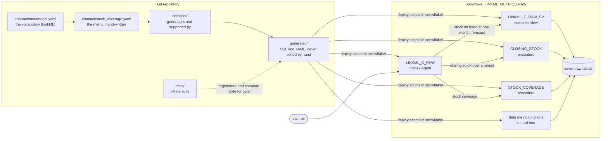

# A guided tour of the repository

This tour follows a business question from the moment a planner asks it to the number, or the explained refusal,
that comes back. It is written for a reader who knows BI and Snowflake but not this repository. It describes the
recommended configuration, C-raw. The measured results are in the [README](../README.md#4-the-evidence) and are not
repeated here.

Tags, as in the README: **[measured]** (run on the account or by the offline suite, evidence in this repository),
**[documented]** (the contract, the code, a generated file or the Snowflake documentation), **[inferred]** (reasoned
from measured facts, not run). The C-raw campaign arm is published as its grades: each turn's answer, as the user
read it, and its verdict (`eval/fixtures/grades_craw-s1.json` and `grades_craw-s2.json`, rubric 3.2; the same files
with `.rubric-3.3` for rubric 3.3). The tool calls and their results sit in the author's run folder and are not
published; they are tagged **[measured, run folder, not published]** and each is paired with its published record
(the grades, `snowflake/session13_craw/results.md`, or `generated/reference_questions.yaml`). Figures come from
published files only; what a recorded tool call alone shows is described in words.

## 1. The problem in business terms

A supply planner does not ask for a table. A planner asks: "For snack bars in Switzerland, what did we close each
month of the second quarter at, and how many months does the June stock last?" A supply chain manager asks: "Which
ten products will stock out first, not counting those already out?" Or: "How much stock value sleeps in pairs with
more than a year of cover?" Each answer depends on rules that are easy to get wrong and hard to see when they are
wrong.

Stock coverage is the main example. It reads the stock at one month and drains it against the forecast of the next
24 months; the result is always in months [documented, `docs/DEFINITION.md`, section 1]. Closing stock is the second.
Over a quarter it is the stock of the quarter's last month, never a sum or an average of the months, and a product
with no stock row that month closes at 0 [documented, `docs/DEFINITION.md`, section 7].

The legacy BI platform this definition follows answered these questions the same way every time, because each
answer was a fixed, generated object. It had no native function for coverage, so each basis needed 24 windowed
cumulative sums, 24 candidate coverages and a 25-branch `CASE`, and the rules on which attribute applies to which
measure were written into each metric [documented, `docs/DEFINITION.md`, section 6]. The answers were repeatable
[inferred]. They were also locked inside that platform (the author's statement).

An agent asked the same question improvises the calculation [inferred, from the measured cases that follow]. On a native semantic view with no month given, the
best build returned a plausible wrong coverage instead of refusing, and it passed a fanned-out number with no warning
[measured, `docs/phase0_findings.md`, section 2]. On a gap in the quarter's last month, native `NON ADDITIVE BY`
carries the previous month's stock into the close [measured, README section 3]. No error is raised, and the number
looks plausible [inferred, README section 3].

This repository declares each rule once, in a YAML contract kept in Git. A compiler turns the contract into Snowflake
objects. The agent's job shrinks to choosing parameters: a generated procedure computes the number, or refuses with
a code and a reason that the agent relays [documented, README section 1].

## 2. Architecture

**The contract.** `contract/stock_coverage.yaml` is the only hand-written source of the generated objects; Git is
their system of record [documented, README section 1]. It is written in the vocabulary of `contract/metamodel.yaml`, a
LinkML schema. The contract declares the tables and their grains, how each measure adds up, which attribute applies
to which measure, the bases (kg or L equivalent, value, the item's own unit), the algorithm, the parameters, 21 refusal
codes in check order, 28 quality expectations and 16 failure modes [documented, README section 2]. The reference of
every key is generated from the metamodel: [reference/metamodel.md](reference/metamodel.md). The failure modes, each with
its trap, are in [reference/failure_modes.md](reference/failure_modes.md).

**The compiler.** `compiler/` holds one Python generator per family of objects (section 4). Each reads the contract
and writes files into `generated/`. A generator stops on a contract value it cannot honour (`compiler/supported.py`,
section 5). It runs locally and on GitHub Actions at every push [documented, `.github/workflows/tests.yml`].

**Git and the tests.** The committed files in `generated/` are the output. `tests/test_generated.py` and
`tests/test_c_raw.py` regenerate them into a temporary folder and fail on any byte of difference, so nothing in
`generated/` is edited by hand [documented, both test files]. A plain `pytest` is the offline suite: the two test files
that call the deployed procedures skip every test unless their own variable is set [documented,
`tests/test_live_gates.py`].

**The objects in Snowflake.** Three objects answer questions in C-raw, all on the seven raw tables, with no reshaped
data [measured, `snowflake/session13_craw/results.md`, section 1a]:
- `LINKML_C_RAW_SV`, a semantic view for stock on hand at one month and for the forecast. It has no coverage and no
  closing-stock metric [documented, `generated/c_raw_sv.yaml`].
- `CLOSING_STOCK`, a SQL Scripting procedure that applies the contract's period rule when the question is asked
  [documented, `generated/closing_stock_procedure.sql`].
- `STOCK_COVERAGE`, a SQL Scripting procedure that computes coverage, recomputes totals and refuses what it cannot
  compute correctly [documented, `generated/stock_coverage_procedure_sql.sql`].

The deploy scripts live in `snowflake/`: `phase3_procedure/deploy.py` for the procedures,
`phase4_others/deploy_sv.py` for the view, `phase4_others/agents.py` for the agent [documented, README section 7].

**The data metric functions.** `generated/dmf.sql` creates 17 custom data metric functions and one ad hoc check per
expectation and column (36). Nothing is attached to a table and no schedule is set; `snowflake/phase2_dmf/run_dmf.py`
runs the checks once [documented, `docs/GUIDE.md`, section 3]. The same expectations are checked a second time inside
each procedure call: the 18 that are not MONITOR refuse or warn, each on the rows its `call_scope` names (the whole
table, the request's members, or the rows the request reads) [documented, `docs/GUIDE.md`, section 4]. The table-level
check monitors the data; the in-call check protects the answer [inferred].

**The agent.** `LINKML_C_RAW` has three tools: the view, `stock_coverage` bound to `STOCK_COVERAGE`, and
`closing_stock` bound to `CLOSING_STOCK`. Its instructions route each kind of question to one tool and forbid it to
compute, add or average a coverage or a closing stock itself [documented, `generated/agent_c_raw.yaml`, `instructions`].
It is called by a service user that holds the project role only [documented, README section 4].

**Why closing stock moved to a procedure.** Configuration C answers closing stock from a
semantic view over a gap-filled snapshot the compiler generates. That view is correct, but it is computed over the
whole snapshot table on every query: a one-quarter question scans 2.0 times the snapshot table [measured, README
section 3]. C-raw applies the same rule at question time on the raw rows of the period asked. The two read the same
closing stock on 12,304 of 12,304 members [measured, README section 3]. C-raw is the configuration this project
recommends [documented, README opening].

**Why coverage needs a tool at all.** A native derived metric over the 24 forward window metrics is rejected by
Snowflake with `010273` [measured, README section 3, from `docs/phase0_findings.md`]. The generated native view of
configuration B2 carries coverage over a precomputed forward spine instead, and on that view stale stock can hide a
stock-out (thread 2). A procedure has neither limit.

## 3. Six questions, end to end

The analysis month of the campaign is June 2026 [documented, `docs/GUIDE.md`, section 5]. Every thread below is a
campaign question played by C-raw, and its outcome is the one recorded in
`snowflake/session13_craw/results.md`, section 4. The ladder follows the article's order: closing stock first, then
coverage.

<!-- SCREENSHOT 1: thread 1 (question N2) asked to LINKML_C_RAW, in Snowflake Intelligence or the agent's chat in Snowsight, with the tool calls expanded (closing_stock and stock_coverage) and the final answer; shows one question routed to two procedures. -->

### Thread 1. Closing stock month by month, then coverage (N2)

**Asked.** "For the SNACK_BARS family in Switzerland, what was the closing stock at the end of each month of Q2 2026,
and how many months of coverage does the June 2026 stock give?" [documented, `generated/reference_questions.yaml`,
N2]. This question was added in stage 2.

**What the agent did.** Two tool calls in one turn. `closing_stock` with three periods (April, May and June 2026, each
a month of its own), the grain family and country, the filters SNACK_BARS and CH, the default basis. `stock_coverage`
with the analysis month June 2026 and the same grain and filters [measured, run folder, not published:
`summary_cr_n2_craw_s2_r1.json`]. The tool description shows the agent this form: "'each month of Q2 2026' is
["2026-04-01", "2026-05-01", "2026-06-01"]" [documented, `generated/agent_c_raw.yaml`, tool `closing_stock`].

**Which contract lines decide.** The measure `stock_on_hand` declares its `period_aggregation`
(`contract/stock_coverage.yaml`, lines 156 to 167): method `LAST_PERIOD`, member set `ANY_SNAPSHOT_IN_PERIOD`,
missing value `"0"`, and `SUM`, `AVERAGE` and `LAST_NON_EMPTY` forbidden. The invariant `INV_CLOSING_LAST_PERIOD`
(line 754) says the same as a testable property. The failure modes `CS_LAST_MONTH_GAP`, `CS_MIDDLE_MONTH_GAP` and
`CS_FAMILY` (lines 824 to 834) name the wrong behaviours.

**What computes it.** `CLOSING_STOCK` runs three statements [documented, `generated/closing_stock_procedure.sql`]:
1. The parameters and the caller, reading no table. A malformed period is refused at once. The grain, filter and
   basis checks are computed here and raised after the context, so that the contract's check order holds.
2. The context. It lists the snapshot months and expands every period into its months. A period with a month that
   has no snapshot is refused with `AS_OF_NO_SNAPSHOT`, its missing months named. The table-level quality
   expectations on the dimensions run in the same statement.
3. The closing rows. Its `base` section reads the snapshot rows between each period's first and last month, so a
   member is any group that holds a row in some month of the period. Its `grouped` section sums only the rows of the
   period's last month: `SUM(IFF(r.snapshot_month = r.last_month, r.qty, 0))`. A member with no row that month gets 0,
   keeps its row, and is marked `closed_without_snapshot`.

Values travel as bind variables, and no SQL text is built at call time [documented, `compiler/gen_closing_procedure.py`,
docstring]. Coverage goes through `STOCK_COVERAGE`, described in thread 2.

**What came back.** Closing stock 900, 350 and 450 for April, May and June, and a coverage of 2.25 months, with no
warning [measured, `eval/fixtures/grades_craw-s2.json`, N2, first repetition; the expected values in `generated/reference_questions.yaml`, N2].

**What the user reads.** One sentence per figure: the three month-end closings on the kg-equivalent basis, then the
June coverage, with the month, the basis and the fact that bulk items are left out by default named [measured,
`eval/fixtures/grades_craw-s2.json`, N2, first repetition].

**The zoom: one product inside the family (CS_LAST_MONTH_GAP).** The family holds SKU-H11, which has stock in May and
no snapshot in June [documented, README section 3]. Asked "What was the closing stock of oat cereal bar 1 kg (SKU-H11)
in Switzerland for Q2 2026?", the agent called `closing_stock` once, for the period 2026-Q2 at the item and country
grain, on the item's own unit. One row came back: closing stock 0, `closed_without_snapshot` true. The answer said
that the item had stock earlier in the quarter but none in June, so it closes at 0 [measured, run folder, not
published: `summary_cr_cs_last_month_gap_craw_s1_r1.json`; the answer in `eval/fixtures/grades_craw-s1.json`]. The wrong answers the trap declares: 350 (May carried into
June), 750 (the months summed), 250 (their average) [documented, `generated/reference_questions.yaml`,
CS_LAST_MONTH_GAP].

<!-- SCREENSHOT 2: Snowsight query history, filtered on the service user, showing one CALL CLOSING_STOCK and its child statements (context, closing) with their durations; blur every query id; shows the three statements and why most of a call is compilation. -->

**The trap it avoids, and where it was measured.**
- On a native semantic view, the best build returns 350 for SKU-H11's Q2 close instead of 0, and the item rows no
  longer add up to the family row: 800 against 450 [measured, README section 3, from
  `snowflake/probe_closing/results.md`, sessions 6 and 7].
- For N2, a view that carries each item's last known value gives 850 for May, 800 for June and a coverage of 4.0
  [documented, `generated/reference_questions.yaml`, N2, `wrong_values`].
- C-raw answered every closing-stock turn of the campaign arm through `closing_stock`, none through the view, and got
  11 of 12 right. The twelfth had the right figures in a table header the rubric does not read [measured, README
  section 4].
- The price of question-time computation: a C-raw closing-stock turn reads 68,000 to 71,000 input tokens against
  about 164,000 for C on its view, and takes 1.3 to 5.3 s longer (median). A call to `CLOSING_STOCK` takes 6.4 s
  (median), 5.2 s of it compiling the statements [measured, `snowflake/session13_craw/results.md`, sections 3 and 4].

### Thread 2. Coverage of a product already out of stock (T9)

**Asked.** "What is the stock coverage of oat cereal bar 1 kg (SKU-H11) in Switzerland as of June 2026?"
[documented, `generated/reference_questions.yaml`, T9]. The same product as the zoom above.

**What the agent did.** One call to `stock_coverage`: analysis month June 2026, grain item and country, filters
SKU-H11 and CH, basis `NATIVE` (the item's own unit). It made the same call in both plays [measured, run folder, not
published: `summary_cr_t9_craw_s1_r1.json`, `summary_cr_t9_craw_s2_r2.json`].

**Which contract lines decide.**
- The stock is selected at the analysis month, never carried: the additivity of `stock_on_hand` over TIME is
  `SELECT_PERIOD`, with the note "read at exactly that month, absent = 0 (T9)" (`contract/stock_coverage.yaml`, line
  147).
- The first outcome of the metric is `SNAPSHOT_NULL_OR_ZERO`: result 0, flag `NO_STOCK`, the member kept (lines 361 to
  367).
- The member exists although it has no stock: members are stock members union forecast members (`MEMBERS_SPINE`,
  lines 437 to 446).
- The forecast window starts the month after the analysis month and runs 24 months, never cut by the month filter
  (`window_start_offset`, `horizon_periods`, `time_filter_on_flow`, lines 354 to 359).

**What computes it.** `STOCK_COVERAGE` first starts four statements that read no table: the parameter checks, and
the text of the data statements. It then checks the analysis months, runs one context statement (the snapshot months
and the valid analysis months), and starts a quality statement and a coverage statement together. Each refusal is
raised at the point the contract's check order allows [documented, `generated/stock_coverage_procedure_sql.sql`, the
comments of the body]. The text of the two data statements is assembled at call time from table and column names
compiled from the contract; the values travel as bind variables [measured, `snowflake/session13_craw/results.md`,
section 1a]. In the coverage statement:
- the `stock_rows` section joins the snapshot on `snapshot_month` equal to the analysis month, so May's row is never
  read for June;
- the `fc_rows` section places each forecast month at its distance from the analysis month;
- the final section evaluates the outcomes in the contract's order, and the first one is
  `WHEN ANY_VALUE(stock_qty) = 0 THEN 'NO_STOCK'`

[documented, `generated/stock_coverage_procedure_sql.sql`].

**What came back.** One row: coverage 0, flag `NO_STOCK`, stock 0, the forecast over the horizon, the stock-out month
equal to the analysis month. No warning [measured, run folder, not published; expected 0 with `NO_STOCK` in
`generated/reference_questions.yaml`, T9].

**What the user reads.** Zero months of cover, measured in the item's own unit, and the flag explained in business
words: no stock on hand in June while demand is still forecast, so the item is already out [measured, `eval/fixtures/grades_craw-s1.json` and
`eval/fixtures/grades_craw-s2.json`, T9].

**The trap it avoids, and where it was measured.**
- An engine that lets `NON ADDITIVE BY` pick the snapshot reads May's 350 and returns 3.5 months [documented,
  `generated/reference_questions.yaml`, T9; `data/traps.yaml`, T9].
- On B2's generated view, the same product returns the right 0 only when the month filter equals June 2026. With a
  range or a quarter it returns 1.1667, and with no month 0.0493 [measured, README section 3].
- The outcome on C-raw: correct in stage 1, wrong in the second repetition of stage 2. The figure was right both
  times, and both calls passed `NATIVE`. The stage 2 answer named the item's own unit where the rubric expects the
  kg-equivalent basis named. The stage 1 answer passed that check only because it quoted the product name "oat
  cereal bar 1 kg", whose "kg" the grader read as the basis named (finding 128) [measured,
  `eval/fixtures/grades_craw-s1.json`, `eval/fixtures/grades_craw-s2.json`; README section 4, Limits].
- The cause is in the instructions. For one item asked with no basis, two sentences of the spec point to different
  bases: the basis rule gives the item's own unit, and the default-parameter sentence gives `QTY_EQ`. C-raw passed
  `NATIVE` in 13 of its 46 coverage calls, C in 7 of 45 [measured, README section 4]. On one item both bases give the
  same months (`INV_NATIVE_EQUALS_QTY_EQ`, `contract/stock_coverage.yaml`, line 744).

### Thread 3. kg and litres in one answer (DIM_MIX)

**Asked.** "What is the stock coverage in France in June 2026?" [documented, `generated/reference_questions.yaml`,
DIM_MIX]. France holds items counted in kg and items counted in L.

**What the agent did.** It called `stock_coverage` at the country grain on the default basis, `QTY_EQ`. The procedure
refused. The agent called again with `VALUE`, the basis the refusal allowed [measured, run folder, not published:
`summary_cr_dim_mix_craw_s1_r1.json`].

**Which contract lines decide.**
- Each basis declares where it is valid. `QTY_EQ` is valid when each row holds one dimension. `VALUE` is always
  valid. `NATIVE` is valid when each row holds one item (`measure_bases`, lines 296 to 320).
- The validity is judged on the rows and totals the call returns, and a basis is refused, never switched silently
  (`basis_model.validity_scope: RETURNED_ROWS`, lines 322 to 341).
- `BASIS_NOT_COMPARABLE` is the last check in the order, number 52, with its reason template (lines 628 to 630).
- The agent's instructions allow one recovery: "If stock_coverage refuses with BASIS_NOT_COMPARABLE, you may call it
  again with a basis the refusal allows, and say that the basis changed and why; never add kg and L yourself"
  [documented, `generated/agent_c_raw.yaml`, `instructions.orchestration`].

**What computes it.** The coverage statement counts the dimensions behind each row it returns and writes a
`BASIS_REASON` when a `QTY_EQ` row holds more than one. The check that runs after the coverage statement raises the
refusal from it [documented, `generated/stock_coverage_procedure_sql.sql`; `compiler/procedure_scripting.py`,
`final_checks`]. The refusal comes from the data, not from a list of countries.

**What came back.** First call: `status: refused`, code `BASIS_NOT_COMPARABLE`, reason "Coverage is always in months,
but on QTY_EQ at least one row or total adds kg and L (items of different dimensions), so stock and forecast cannot
be summed for this request. Bases allowed for this request: VALUE." Second call: 8.70 months on value, with the
warnings `FORECAST_GAPS_FILLED` and `DEFAULT_SCOPE_EXCLUDED` [measured, run folder, not published; the reason template
and the value 8.70 in `generated/reference_questions.yaml`, DIM_MIX].

**What the user reads.** About 8.7 months, on value; why the quantity basis was refused (France mixes kg and L); and
both warnings, each with its number [measured, `eval/fixtures/grades_craw-s1.json`, DIM_MIX]. The README quotes C's answer to the same
question [documented, README section 4, "Refusals, as the agent wrote them"].

<!-- SCREENSHOT 3: DIM_MIX in Snowflake Intelligence or the agent's chat: the first stock_coverage call with its refused result (code and reason), the second call on VALUE, and the answer that names the switch; shows a refusal relayed and recovered within its rule. -->

**The trap it avoids.** Adding kg and L on the quantity basis gives 10.21 months, a figure that looks plausible
[documented, `generated/reference_questions.yaml`, DIM_MIX, `kg_and_l_added`]. C-raw answered correctly in both
stages [measured, `snowflake/session13_craw/results.md`, section 4].

**A refusal with no way around it (T7_R1).** "What is the stock coverage of cooking oils in Sweden by lifecycle status
as of June 2026?" One item has two master-data rows that disagree on its lifecycle status. The procedure refuses with
`MASTER_DATA_FANOUT` (quality expectation `QE_ITEM_GRAIN`, `on_failure: REFUSE_IF_USED`, line 656). No basis fixes it,
so no figure is given [documented, `contract/stock_coverage.yaml`; `generated/reference_questions.yaml`, T7_R1]. The
C-raw answer said why and offered the coverage without the lifecycle split [measured, `eval/fixtures/grades_craw-s1.json`, T7_R1]. Configurations A, B1, B2 and D gave the fanned-out 2.25 and 6.0 in stage 1
[measured, README section 4].

### Thread 4. No analysis month (T6)

**Asked.** "What is the stock coverage of flour and baking in France over the whole year 2026?" [documented,
`generated/reference_questions.yaml`, T6]. Coverage is a point-in-time measure: a year has no single coverage.

**What the agent did.** No tool call. It answered with a question: which month? It said that the latest month is June
2026, gave the range of valid months, and offered a monthly series instead [measured, `eval/fixtures/grades_craw-s1.json` and `eval/fixtures/grades_craw-s2.json`, T6: routing
"no tool call"].

**Which contract lines decide.**
- The parameter `as_of_months` says: "If the user gives no month, or a period (a year, a quarter), ask which month:
  never pick one" (`contract/stock_coverage.yaml`, lines 479 to 491). The generated instructions repeat it, with the
  latest month compiled from the dataset [documented, `generated/agent_c_raw.yaml`].
- If the agent had called the tool with no month, `AS_OF_MISSING` would have refused first: it is the first code of
  the check order (`check_order: 10`, line 570). Its reason: "An analysis month is required. Coverage is a
  point-in-time measure..."
- A series is allowed (`series_allowed: true`, at most 24 months, lines 473 to 474), with no total across months
  (`total_over_time: FORBIDDEN`, line 433).

**What computes it.** Nothing ran, which is the point. Had a call been made, the analysis-month check of
`STOCK_COVERAGE`, a statement that reads no table, would have refused it [documented,
`generated/stock_coverage_procedure_sql.sql`, the comments of the body]. The expected
route of T6 is `clarify` [documented, `generated/reference_questions.yaml`, T6].

**What the user reads.** A short question and the months available. No figure.

<!-- SCREENSHOT 4: T6 in Snowflake Intelligence or the agent's chat: the clarifying answer, with the trace showing that no tool was called; shows that an imprecise question gets a question, not a guess. -->

**The trap it avoids.** "Coverage over the year (meaningless)" is the declared wrong behaviour (failure mode T6, line
797). The native semantic view of phase 0, given no month, returned a plausible wrong number instead of refusing
[measured, `docs/phase0_findings.md`, section 2]. A semantic-view variable with no default can make the query fail, but
only on omission [measured, same section, session 2 addendum]. C-raw asked for the month in both stages [measured,
`snowflake/session13_craw/results.md`, section 4, class REFUSAL].

### Thread 5. The default scope, then a drill (BULK_SCOPE)

**Asked.** "What is the stock coverage of ground coffee as of June 2026?", then "And by country?" [documented,
`generated/reference_questions.yaml`, BULK_SCOPE and BULK_SCOPE_DRILL]. Ground coffee holds bulk stock, which is never
forecast.

**What the agent did.** First turn: `stock_coverage` at the family grain, filter HOT_GROUND, June 2026, default basis.
Second turn: the same filter, with country added to the grain, in a second call [measured, run folder, not published:
`summary_cr_bulk_scope_craw_s1_r1.json`, `summary_cr_bulk_scope_drill_craw_s1_r1.json`]. The instructions say that
"a follow-up such as 'and by country?' keeps the filters of the previous question and adds the attribute to the
grain" [documented, `generated/agent_c_raw.yaml`].

**Which contract lines decide.**
- The default scope `SCOPE_ITEM_TYPE` keeps STANDARD items for coverage, lifted only by an explicit filter on
  `item_type`, and raises `DEFAULT_SCOPE_EXCLUDED` (`contract/stock_coverage.yaml`, lines 448 to 459).
- The warning's template carries the excluded amount per unit (lines 633 to 635). Missing forecast months count as 0
  and are reported by `FORECAST_GAPS_FILLED` (lines 636 to 638, expectation `QE_FORECAST_DENSE`, line 690).
- A coarser figure is recomputed, never added from the rows: `TOTALS_RECOMPUTE` (lines 424 to 435).
- Closing stock is not scoped: it counts every item type (the description of `item_type`, line 284).

**What computes it.** The parameter statement turns the scope on (`scope_on`) when no filter names `item_type`.
The coverage statement keeps the scoped items. The quality statement sums the stock left out, per analysis month and
unit, into the warning [documented, `generated/stock_coverage_procedure_sql.sql`; `compiler/procedure_scripting.py`,
docstring]. The
drill is a second call at a finer grain. The family figure is never rebuilt from the country rows.

**What came back.** For the family: 8.67 months on the kg-equivalent basis, with `DEFAULT_SCOPE_EXCLUDED` (51,475.5 kg
of bulk stock left out) and `FORECAST_GAPS_FILLED` (2 member-months). For the drill: six country rows, from 1.93
months in Spain to 11.38 in Belgium, with the same two warnings [documented, `generated/reference_questions.yaml`;
measured, `eval/fixtures/grades_craw-s1.json`, BULK_SCOPE and BULK_SCOPE_DRILL].

**What the user reads.** The family figure, "standard items only", and both warnings in business words, then a table
of six countries, with no average or sum of the country figures [measured, `eval/fixtures/grades_craw-s1.json`, BULK_SCOPE and BULK_SCOPE_DRILL].

<!-- SCREENSHOT 5: BULK_SCOPE then "And by country?" in one conversation, with the two warnings visible under the first answer; shows that the answer reports what it removed and that a drill is a new call. -->

**The trap it avoids.** Counting bulk stock against a forecast that only covers standard items gives 17.44 months for
the family, twice the right figure [documented, `generated/reference_questions.yaml`, BULK_SCOPE,
`bulk_counted_by_default`; failure mode BULK_SCOPE, line 812]. Averaging the six country rows back to a family figure
would be trap T1 [documented, failure mode T1, line 782]. C-raw answered both questions correctly in both stages
[measured, `snowflake/session13_craw/results.md`, section 4].

### Thread 6. A plain question, answered by the semantic view (G1)

**Asked.** "What is the demand forecast of fruit juice in France for September 2026, in kg or L equivalent?"
[documented, `generated/reference_questions.yaml`, G1]. No rule beyond a filter and a sum: the semantic view is
enough.

**What the agent did.** It called the view tool, which returned the view's model. It then ran one query on the view:
the forecast in kg or L equivalent for the juice family, France and September 2026, grouped by the items' dimension
[measured, run folder, not published: `summary_cr_g1_craw_s1_r1.json`].

**Which lines decide.** The routing sentence sends "questions on stock on hand at one month and on demand forecast"
to the view [documented, `generated/agent_c_raw.yaml`]. The forecast is a FLOW, summed over months (lines 168 to 182
of the contract). The view's metric `forecast_qty_eq` warns that kg and L never add up: "group or filter by dimension
when items of both dimensions are combined, or use the value metric" [documented, `generated/c_raw_sv.yaml`, table
`forecast`]. The agent grouped by dimension, as that text asks [measured, run folder, not published].

**What computes it.** Snowflake's semantic view engine, on the raw `FCT_FORECAST` joined to the item and country
dimensions. No procedure runs [documented, `generated/c_raw_sv.yaml`].

**What came back, and what the user reads.** 6,416 L equivalent, all juice items being counted by volume [documented,
`generated/reference_questions.yaml`, G1; measured, `eval/fixtures/grades_craw-s1.json`, G1].

**The trap it avoids.** The declared wrong answers: 764 (raw units of different pack sizes summed), 5,899 (the
forecast of June instead of September), 20,721 (June to September cumulated) [documented,
`generated/reference_questions.yaml`, G1]. C-raw was correct in both stages. Its view turn read a median of 122,338
input tokens in stage 1, against 163,780 for C on B2's view [measured, `snowflake/session13_craw/results.md`,
section 4].

## 4. The generators

Each generator reads the contract (the path can be overridden with `--contract`, except for `gen_questions.py` and
`gen_reference.py`) and writes into `generated/` (or `docs/reference/`). Each one that writes a fixed key's behaviour
calls `supported.check()` first [documented, `compiler/supported.py`, docstring].

### `gen_schema.py`
- **Reads:** `tables`, their columns and grains, `attributes` with their applicability classes, `measure_bases`.
- **Writes:** `generated/schema.py`, a Python module.
- **Becomes:** no Snowflake object. The loader, the dataset checks and the tests import it.
- **Held by:** `tests/test_generated.py` (drift) [documented, the docstrings].

### `gen_dmf.py`
- **Reads:** `quality_expectations`.
- **Writes:** `generated/dmf.sql`: a `CREATE DATA METRIC FUNCTION` for each expectation marked CUSTOM, and one ad hoc
  `SELECT` per check.
- **Becomes:** 17 custom data metric functions in `LINKML_METRICS.RAW`, attached to nothing and unscheduled.
- **Held by:** `tests/test_generated.py`, which also checks that every expectation is covered and nothing is attached
  [documented, `compiler/gen_dmf.py`; counts from `docs/GUIDE.md`, section 3].

### `gen_closing_sv.py`
- **Reads:** the snapshot measure's `period_aggregation`, its attributes and bases.
- **Writes:** `generated/closing_stock_sv.sql`.
- **Becomes:** the gap-filled view `FCT_STOCK_SNAPSHOT_GAPFILLED` (one row per key and month from its first snapshot
  to its last + 1, missing measures at 0) and the semantic view `CLOSING_STOCK_SV`. Configurations C and B2 read the
  gap-filled view; C-raw does not.
- **Held by:** `tests/test_generated.py` [documented, `compiler/gen_closing_sv.py`].

### `gen_procedure.py`, with `procedure_scripting.py` and `procedure_handler.py`
- **Reads:** nearly the whole contract: measures and columns per basis, attributes and joins, the metric, the totals
  and member rules, the default scope, parameters, refusal codes in check order, warnings, in-call quality
  expectations.
- **Writes:** `generated/stock_coverage_procedure_sql.sql` (SQL Scripting, `procedure_scripting.py`) and
  `generated/stock_coverage_procedure.sql` (Python, `procedure_handler.py` with its `CONTRACT` line filled in).
- **Becomes:** `STOCK_COVERAGE`, the procedure C and C-raw call, and `STOCK_COVERAGE_PY`, kept beside it.
- **A built-in check:** the generator stops when a refusal code has no check, a check has no code, or the stages break
  the contract's check order (`procedure_scripting.py`, function `body`).
- **Held by:** `tests/test_generated.py` (drift; and the SQL target shares no code with the reference
  implementations); `tests/test_procedure.py` against the deployed procedure, only with `LINKML_PROCEDURE_LIVE=1`
  [documented, the docstrings and the tests].

### `gen_closing_procedure.py`
- **Reads:** the `period_aggregation`, the attributes, the bases and basis model, the refusal codes and the in-call
  quality expectations.
- **Writes:** `generated/closing_stock_procedure.sql`.
- **Becomes:** `CLOSING_STOCK`, the three statements of thread 1.
- **Fixed in the generator:** the contract's refusal templates were written for coverage. Eight of them name coverage
  or `as_of_months` and are reworded here (`REWORDED`, line 61); the generator stops if the contract's original text
  changes. The object name is a constant (`PROCEDURE`, line 50).
- **Held by:** `tests/test_generated.py` (drift); `tests/test_closing_procedure.py`. Offline, it checks that both
  references agree on every member and grain, that the procedure reads the raw tables only, the codes in order, the
  reworded templates, the three statements and their lineage, and that an unsupported period rule fails closed. On the
  account, with `LINKML_CLOSING_LIVE=1`, it checks the heroes, the refusals, totals and a sample against the reference
  [documented, the test file].

### `gen_agent.py`
- **Reads:** the tool surface: the metric's name, synonyms and description, the parameters, the bases, the default
  scope, the flags, the attributes with their known values. The valid analysis months are read from the loaded
  dataset.
- **Writes:** `generated/agent_c.yaml`.
- **Becomes:** agent C's `CREATE AGENT` specification. `gen_craw.py` reuses its instructions.
- **Held by:** `tests/test_generated.py` (drift, and the input schema matches the contract's parameters);
  `tests/test_charter_conformity.py`, which checks every sentence the fairness charter
  ([configurations.md](configurations.md)) imposes [documented, the docstrings].

### `gen_craw.py`
- **Reads:** the contract, the loaded dataset (the snapshot months), and the value grounding of B2's enriched view as
  deployed (`snowflake/phase4_others/b2/LINKML_B2_SV_enriched.yaml`, line 49), so that C-raw's view grounds values
  as C's did.
- **Writes:** `generated/c_raw_sv.yaml` and `generated/agent_c_raw.yaml`.
- **Becomes:** the semantic view `LINKML_C_RAW_SV` (raw tables only, stock on hand `NON ADDITIVE BY` the snapshot
  month, no coverage or closing-stock metric, no verified query) and the agent `LINKML_C_RAW` (three tools; C's
  instructions with the closing-stock routing rule).
- **Held by:** `tests/test_c_raw.py`: drift, raw tables only, the three tools, the routing, the grounding equal to
  B2's, no internal reference and no em dash in the specs [documented, the test file].

### `gen_native_sv.py`
- **Reads:** the contract.
- **Writes:** `generated/b2_native_views.sql`, `generated/b2_native_sv.yaml`, `generated/agent_b2.yaml`.
- **Becomes:** configuration B2, the generated native baseline: a forward spine, a status bridge, an item projection,
  a semantic view with coverage as a derived metric, and its agent. C-raw uses none of it.
- **Held by:** `tests/test_generated.py` [documented, `compiler/gen_native_sv.py`].

### `gen_questions.py`
- **Reads:** the contract's failure modes, `data/traps.yaml` and the dataset. It has no `--contract` option.
- **Writes:** `generated/reference_questions.yaml`, the campaign's questions with their expected values, flags,
  warnings, refusals and tool parameters.
- **Becomes:** no Snowflake object. It feeds the harness and the grader in `eval/`.
- **Held by:** `tests/test_generated.py` (drift; every failure mode has a question); `tests/test_reference_oracle.py`,
  which recomputes every expected value in pandas, never from the procedure; `tests/test_procedure.py` on the
  account [documented, the docstrings].

### `gen_reference.py`
- **Reads:** `contract/metamodel.yaml`, the contract, `data/traps.yaml` and `compiler/supported.py`.
- **Writes:** `docs/reference/metamodel.md` (every key, each fixed or documentation-only key marked) and
  `docs/reference/failure_modes.md`.
- **Held by:** `tests/test_reference.py` (drift, and every link of the published guides resolves) [documented, its
  docstring].

### `supported.py`
- **Holds:** `FIXED` (line 75), 26 keys the compiler does not read, each with the one value supported and the
  generators that write its behaviour; `DOCUMENTATION_ONLY` (line 118), 12 keys that carry no behaviour [measured,
  counted].
- **Does:** `check()` (line 134) raises on the first fixed key that holds another value, with the message
  "`<key>: only <value> is supported by this compiler`".
- **Held by:** `tests/test_supported.py`. A contract that changes any fixed key must stop every generator that writes
  it, and the current contract must still generate identical files [documented, its docstring].

### The tests around the generators
- **Drift.** `tests/test_generated.py`, `tests/test_c_raw.py` and `tests/test_reference.py` regenerate and compare
  byte for byte.
- **The contract itself.** `tests/test_contract.py` validates both files with LinkML. It then resolves every reference
  that `linkml-validate` does not check: a `prevents: [T99]` passes validation, not this test [documented,
  `docs/GUIDE.md`, section 3].
- **Fail closed.** `tests/test_supported.py`, and `test_an_unsupported_period_rule_fails_closed` in
  `tests/test_closing_procedure.py`.
- **No accidental cost.** `tests/test_live_gates.py`: a plain `pytest` never calls Snowflake.

<!-- SCREENSHOT 6: a terminal running `python -m pytest tests/test_supported.py tests/test_generated.py -q`, all green; optionally a second capture of the error a generator prints on a copy of the contract with time_grain DAY (`only MONTH is supported by this compiler`); shows that the compiler refuses what it cannot generate. -->

## 5. What is generic today and what is fixed

**Generic, measured on a second metric.** A dry run compiled a cash runway contract of the same pattern (a cash
balance drained by planned spend) with every generator, offline. Written with no name shared with stock coverage, it
validates against the metamodel, and the schema, the data metric functions and the closing view generate from it.
The procedure and the agent specification generate only when the contract reuses stock coverage's vocabulary: the 8
parameter ids, the 21 refusal code ids, three bases, a calendar named `DIM_CALENDAR`, and a `grain_rule`
[measured, `docs/dry_run/results.md`]. The dry run predates `gen_closing_procedure.py` and `gen_craw.py` (session 11
against session 13) [documented, both files].

**Fixed.** What a second metric would have to open, from `compiler/supported.py`, `docs/GUIDE.md` section 6 and
`docs/dry_run/results.md`:
- **One metric type.** The metamodel's `metrics` slot accepts `DepletionMetric` only, and the compiler reads the first
  entry [documented, `contract/metamodel.yaml`, the `metrics` slot]. A ratio, a rate over a period or a cohort has no
  class and no template [documented, `docs/GUIDE.md`, section 6].
- **One time grain.** `time_grain: MONTH` is fixed for the measures and the metric. The metamodel's grains run from
  DAY to YEAR, but the procedures count in months (`DATEDIFF(month, ...)`) [documented, `compiler/supported.py`;
  `docs/GUIDE.md`, section 8].
- **One algorithm.** The output unit (months), the anchor parameter (`as_of_months`), LINEAR interpolation,
  densified missing periods, aggregation before compute, the time filter that selects the anchor only, the four
  outcomes in their order, and the beyond-horizon rule (snapshot over the mean non-zero flow of the horizon)
  [documented, `compiler/supported.py`, `FIXED`].
- **One totals rule.** `RECOMPUTE`, with `TOTAL_GRAIN` for the snapshot, `CONFORMED_PROJECTION` for the flow, and no
  total over time. Members by `SPINE`, snapshot members always kept. A default scope lifted by an explicit filter only
  [documented, same list].
- **One period rule.** `ANY_SNAPSHOT_IN_PERIOD` as the member set of a closing measure. `AVERAGE` is listed among
  the forbidden period methods, so a rate over an average level cannot be declared with it today [documented,
  `compiler/supported.py`; `docs/GUIDE.md`, section 6].
- **The parameters' bounds.** At least one value, at most the analysis periods' `max_periods`, and the allowed bases
  equal to the ids of `measure_bases`, in order [documented, `compiler/supported.py`].
- **Names.** The objects are constants in the generators: `STOCK_COVERAGE`, `CLOSING_STOCK_SV`, the tool
  `stock_coverage` [measured, `docs/dry_run/results.md`]; `CLOSING_STOCK` (`compiler/gen_closing_procedure.py`, line
  50) and `LINKML_C_RAW_SV`, `LINKML_C_RAW`, `closing_stock` (`compiler/gen_craw.py`, lines 43 to 46) [documented]. A
  second metric deployed in the same schema would replace the first one's objects [inferred, `docs/dry_run/results.md`].
- **Text.** The procedure's answer keys are named after stock, the agent's tool description mixes the contract's text
  with fixed stock coverage sentences, and 8 refusal texts of `CLOSING_STOCK` are written in the generator [measured,
  `docs/dry_run/results.md`; documented, `compiler/gen_closing_procedure.py`].
- **The question set.** `gen_questions.py` takes no `--contract` and reads `data/traps.yaml` [measured,
  `docs/dry_run/results.md`].

**Where a contract-authoring tool would plug in.** The code has three seams for it [documented, the files named]:
1. **The contract file.** It is the only hand-written input of the generated objects.
2. **Its validation.** `linkml-validate -s contract/metamodel.yaml -C MetricContract <contract>` checks the shape
   [documented, `docs/GUIDE.md`, section 6]. The checks of `tests/test_contract.py` resolve the references between
   sections, and `supported.check()` names any value the compiler cannot honour, in one sentence per key.
3. **The generators.** All but two take `--contract` and `--out` or `--out-dir`, and write deterministic files.

`docs/reference/metamodel.md` is already generated from the metamodel, with every fixed key marked
[documented, `compiler/gen_reference.py`].

## 6. A reading order for the code

1. [`docs/DEFINITION.md`](DEFINITION.md), sections 1 and 7: what coverage and closing stock mean, in business words.
2. [`contract/stock_coverage.yaml`](../contract/stock_coverage.yaml): the metric, the rules and the traps, top to
   bottom; [CONTRACT.md](CONTRACT.md) reads it section by section.
3. [`docs/reference/failure_modes.md`](reference/failure_modes.md): the 16 ways to get it wrong, each with its trap.
4. [`data/traps.yaml`](../data/traps.yaml): each trap's member, its right value and the value of each wrong one.
5. [`docs/reference/metamodel.md`](reference/metamodel.md): the vocabulary, every key, the fixed ones marked.
6. [`compiler/supported.py`](../compiler/supported.py): what the compiler refuses to generate.
7. [`compiler/gen_closing_procedure.py`](../compiler/gen_closing_procedure.py): the closing-stock generator, one file
   where coverage takes three.
8. [`generated/closing_stock_procedure.sql`](../generated/closing_stock_procedure.sql): its output; read statement 3.
9. [`compiler/gen_procedure.py`](../compiler/gen_procedure.py), then
   [`compiler/procedure_scripting.py`](../compiler/procedure_scripting.py): the coverage procedure and its check stages.
10. [`generated/stock_coverage_procedure_sql.sql`](../generated/stock_coverage_procedure_sql.sql): `STOCK_COVERAGE` as
    deployed.
11. [`compiler/gen_craw.py`](../compiler/gen_craw.py), then
    [`generated/agent_c_raw.yaml`](../generated/agent_c_raw.yaml): the view and the agent; read the instructions in
    full.
12. [`tests/test_generated.py`](../tests/test_generated.py), [`tests/test_supported.py`](../tests/test_supported.py)
    and [`tests/test_closing_procedure.py`](../tests/test_closing_procedure.py): what holds it all together.
13. [`eval/grade.py`](../eval/grade.py), with [`eval/rubric.yaml`](../eval/rubric.yaml): how an answer is judged.
14. [`snowflake/session13_craw/results.md`](../snowflake/session13_craw/results.md): what C-raw did on the account.
